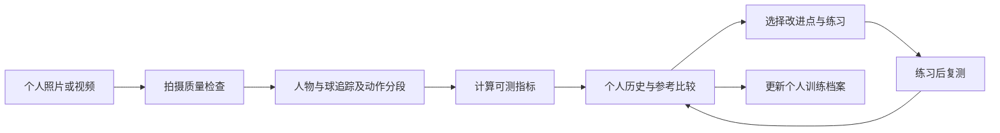

# 自用运动分析技术探索

日期：2026-11-17。状态：第一段网页与服务端已在 `生野 · Khepri` 目录实现，合成素材工程验证通过；运动分析仍处于技术探索，尚未运行真实运动视频实验。开发入口见 [Khepri 启动说明](<../生野 · Khepri/README.md>)，实测记录见 [第一段开发验证](<../生野 · Khepri/docs/第一段开发验证.md>)。

当前目标是为项目所有者本人制作一个持续使用的运动分析工具：上传照片或视频，观察动作、比较参考、选择练习，再用后续拍摄检验变化。探索范围同时覆盖篮球与 60／100／200 米短跑。允许某项能力因测量条件或技术效果不足暂时搁置，保留原因和恢复条件。

运动员／长期专项爱好者版与大众教学版是未来面市方向。当前按单人自用设计，个人影像、训练档案和反馈默认留在个人工作区。现阶段的主要交付是可信的动作分析与复测记录。

交付顺序按 2026-11-17 的最新要求确定：先完成网页端和服务端，再完成手机端。自用版分六段验收，前五段在电脑浏览器上测试，第六段在本人的 iPhone 17 Pro 上测试。各段标准见第 12 节；手机仍可用于前期拍摄，素材先导入电脑再上传。

## 1. 已明确的要求和未确定的条件

| 项目 | 当前约定 |
| --- | --- |
| 使用者 | 当前只为本人使用 |
| 交付顺序 | 网页端与服务端先行，手机端最后验收；前五段不要求手机客户端完成 |
| 手机测试设备 | iPhone 17 Pro；iOS 版本在首次真机测试时记录 |
| 篮球范围 | 投篮、运球、突破变向、上篮、起跳与落地均进入探索清单；后续按实际素材补充传球、防守移动等 |
| 短跑范围 | 60／100／200 米；按起跑、加速、最高速度、速度维持，以及 200 米弯道与直道转换分别分析 |
| 输入 | 个人照片、视频、训练目标与主观反馈；可引入有来源的高水平参考素材 |
| 输出 | 可回看的动作证据、可解释指标、参考差异、建议与练习、复测变化 |
| 推进方式 | 多方向建立小实验，按证据决定继续、降级或暂缓；不要求先放弃某项运动 |
| 尚待实际素材确定 | 实际拍摄设置、可用视角、原始帧率与时间戳、训练环境、个人技术水平、参考素材质量 |

未知条件先在每份素材中标记，不将它们补写为事实。没有个人影像时，可以验证数据处理与算法接口，但不能宣称已验证本人动作分析的准确性。

## 2. 一次使用的完整过程

每份报告区分三个层次：

1. **观察与测量**：例如某个可见阶段持续多久、二维投影角度如何变化；附原视频位置、单位和质量标记。
2. **解释与假设**：该差异可能与什么有关、哪些条件下才值得调整；注明依据及不确定性。
3. **练习与验证**：采用哪项有依据的练习，练习目的、执行说明、完成标准和复测方法是什么。

推理模型负责组织解释、选择相关资料和跟踪反馈。角度、时间与轨迹由可复算的程序产生。报告中每个数值应能追溯到输入帧和计算版本。

## 3. 技术探索矩阵

下表均为拟验证的技术路径，不代表已实现或已达到所需精度。各行可以并行开展，某行暂停不阻塞其他行。

| 方向 | 首先尝试的输出 | 关键输入与依赖 | 初期降级或暂缓项 | 验证方法 |
| --- | --- | --- | --- | --- |
| 照片与静态姿态 | 可见身体关键点、骨架叠加、同视角的投影角度 | 完整身体或目标关节可见，保留原图比例 | 动作速度、发力顺序、完整动作评价 | 与人工标点比较；测试裁剪、旋转、宽高变化 |
| 罚球、定点投篮与跳投 | 准备／抬球／出手／随动分段，身体角度曲线，出手事件与重复稳定性 | 身体和球同时可见，记录位置、距离、惯用手、是否起跳；命中结果可人工录入 | 无标定时的真实出手速度、精确三维出手角、手指施力 | 人工复核出手帧；同条件多次投篮比较动作指标与命中表现 |
| 运球与突破 | 球与身体相对位置、运球节奏、脚步事件、可见路线 | 球的检测与追踪、人物身份追踪、完整脚部视野 | 球被遮挡时的连续轨迹、控球力量 | 人工标注触球／触地和脚步，统计漏检与身份切换 |
| 变向与防守移动 | 支撑脚事件、躯干倾斜投影、变向前后路线和阶段时间 | 合适的侧面或斜前方视角；地面距离测量需要场地标定 | 横向力、关节负荷、损伤风险评分 | 与人工事件标注比较；测试同动作不同视角的一致性 |
| 上篮、起跳与落地 | 步序、起跳／出手／落地时点、左右侧重复性 | 脚、球、篮筐尽量可见，标明单脚或双脚动作 | 未校准的绝对跳高、落地冲击力、自动医疗判断 | 人工事件标注；相同拍摄条件下的重复试次 |
| 短跑起跑 | 预备姿态、第一动作、离开起跑器及前几步时序 | 侧面拍摄、可见脚部和起跑器；测反应时间另需同步起跑信号 | 无起跑信号时的反应时、蹬地力 | 人工标注关键帧；与明确计时起点对齐 |
| 直线加速 | 步频变化、步序、躯干姿态变化；有标定时的分段速度 | 固定视角覆盖目标区间，已知距离标记，可靠原始时间轴 | 未校准的米制步长和速度、移动镜头下直接读位移 | 独立计时或人工过线记录对照；重复采集 |
| 最高速度阶段 | 步频、周期稳定性；足部可清晰分辨时估计接触／腾空时间 | 足部清晰的高速视频，拍摄区间明确 | 低帧率下的精细接触时间、单视频肌肉功率 | 人工标注接触事件，报告帧级时间分辨率及误差 |
| 60／100 米全程 | 关联各拍摄区间、分段成绩、前后程动作变化 | 分段视频与计时可对齐；记录场地、起跑方式、鞋、风及当次条件 | 从一个局部片段外推完整比赛成绩 | 对照实测分段与总成绩；不同条件分组比较 |
| 200 米弯道与直道 | 分阶段节奏、可见身体倾斜、出弯前后变化 | 标注道次、弯道位置、镜头视角；按区间拍摄和计时 | 直接套用直道坐标、未校准的三维倾斜角和向心力 | 分别验证弯道与直道，再检查转段处连续性 |
| 多人对抗和比赛片段 | 指定人物追踪、动作片段检索、可见事件辅助标注 | 人物身份确认、遮挡检测、足够清晰的原片 | 长时间遮挡恢复、仅凭骨架判断战术最优解 | 身份追踪人工复核，低质量片段降为人工回看 |

照片支持静态观察；视频的时间分析需要原始时间戳。慢放视频、插帧视频、剪辑和变速素材必须标注，无法恢复真实时间关系时只保留空间观察。地面平面标定可帮助测地面位置，不能直接用于还原离地的球或手的三维轨迹。

## 4. 数学和视觉算法如何分工

- **骨架拓扑**：用节点表示身体关键点、用边表示肢段连接，维护左右侧与关节链关系。它为计算提供结构。
- **几何与运动学**：计算坐标关系、投影角、经验证的三维估计、时间间隔及变化率。图像归一化坐标先恢复宽高比例；二维投影角和解剖三维关节角必须分别命名。
- **目标检测与追踪**：跟踪人、球及必要的场地参照。人体姿态模型与球检测是不同任务。
- **时序分析**：先识别出手、触地、离地、过线等事件，再比较对应阶段。轨迹可做时间对齐，但原始持续时间和节奏单独保留。
- **统计与误差分析**：用多次动作建立个人范围，估计重复测量波动。只有变化超过相应误差且可重复时，才报告为可信变化。
- **进阶探索**：三维重建、肌骨模型、轨迹聚类和拓扑数据分析可分别试验；根据它们是否改善已定义指标决定是否保留。

## 5. 高水平参考库怎样使用

参考对象按具体动作、动作阶段、任务条件与技术风格组织，不预先选定一个通用于所有人的“最佳模板”。可以借鉴不同运动员的技术长处，但要保留完整关节链和动作目的，避免将不同人的局部角度拼成未经验证的标准。

每份参考记录至少包含来源、运动员、动作与阶段、惯用侧、拍摄条件、已知个人条件、可用指标和素材使用范围。资料未知时保留未知。身体比例、机位和动作条件不相近的素材，主要用于定性示范。

同一次分析提供三种比较：

1. **本人历史比较**：本次与同条件下过去的动作有什么变化。
2. **本人有效动作比较**：本次与自己表现较好且可重复的动作有什么差异。
3. **高水平参考比较**：在适用条件下，参考动作提供哪些可检验的技术假设。

动作相似度只是描述指标。投篮距离和运动水平会影响出手参数，已有研究观察到这些条件下的动作调整；因此不能从一个固定角度直接推导所有人的训练目标。[投篮距离研究](https://pubmed.ncbi.nlm.nih.gov/24149195/)

## 6. 可复用技术与当前证据

| 技术路线 | 已核实的能力 | 在本项目的用途与限制 |
| --- | --- | --- |
| [MediaPipe Pose Landmarker](https://developers.google.com/edge/mediapipe/solutions/vision/pose_landmarker) | 图片和视频身体关键点，33 点骨架、图像坐标与三维估计，具有 Web 接口 | 先试个人片段骨架叠加和可见关节分析；不自带篮球轨迹或专项技术评分 |
| [MMPose](https://github.com/open-mmlab/mmpose) | 基于 PyTorch 的姿态估计工具箱，含多种人体、手部及全身模型 | 作为复杂遮挡、关键点类型和模型对照路线；需要评估额外运行环境 |
| [Ultralytics 追踪接口](https://docs.ultralytics.com/modes/track/) | 检测与目标身份追踪，可接自定义模型 | 尝试人和球联合追踪；小球、模糊和遮挡精度需篮球实测；模型与代码版本、许可分别记录 |
| [OpenCap 多机研究](https://journals.plos.org/ploscompbiol/article?id=10.1371/journal.pcbi.1011462) | 多手机视频结合标定与人体模型估计运动学、动力学 | 用于研究更规范的三维测量路线，不能将研究误差直接套到篮球和高速短跑 |
| [OpenCap Monocular 研究](https://arxiv.org/abs/2603.24733) | 单手机视频与模型优化估计三维运动学；论文验证包括步行、深蹲、起坐 | 单目三维列为试验路线；现有验证不构成篮球、短跑精度保证 |
| [World Athletics 生物力学研究资料](https://worldathletics.org/about-iaaf/documents/research-centre) | 包含世界锦标赛短跑分段与运动学分析报告 | 借鉴专项阶段和指标定义；分别检查报告条件与当前采集是否可比 |

主应用、数据契约与 Agent 编排仍可按原方案使用 TypeScript，Rust 保留为进程监督候选。Python 视觉工具先列为可替换的独立实验服务，不因此默默改写原文档的语言约束。若采用某条路线，再记录实际依赖与架构调整。

## 7. 自用界面与个人 Agent

先设计四个工作区：

1. **素材台**：导入个人影像、保留原片、记录拍摄条件、剪选动作片段；支持手动修正事件和错误关键点。
2. **动作对比台**：本人和参考并排回放，按事件同步，显示骨架、轨迹、阶段时长与质量标记；随时返回原片。
3. **训练台**：展示本轮优先问题、依据、练习说明和复测标准，记录实际执行与感受。
4. **个人档案**：查看按运动、动作和训练周期归档的变化，允许纠正、删除或撤销对个人习惯的推测。

主 Agent 持续记住：当前目标、可用训练时间和设备、表达偏好、已尝试练习、本人反馈、实际复测结果。每条记忆标注来源与时间，区分明确要求、系统推测和算法测量。主 Agent 根据这些记录安排分析与复测，不将未经验证的动作判断写成永久事实。

Skill 用来表达各专项的分析和复测流程。MCP 可用于连接素材、训练记录或其他数据服务。早期本地能力可以直接通过内部接口调用，再按实际复用需要开放为 MCP 服务。

## 8. 分析报告与练习建议

每份报告应包含：

- 本次分析范围、素材质量、可分析和不可分析的区间。
- 关键动作片段与事件时间点；允许人工修正自动结果。
- 少量与本次目标相关的指标；给出单位、计算方法、可信度和参考条件。
- 观察差异与技术解释分别列出；说明为什么该差异值得测试。
- 优先改进点、候选练习、练习依据及适用条件。具体训练量结合个人记录确定，不能只根据一帧图像生成。
- 复测时如何拍摄、比较哪些动作指标和实际表现。
- 复测结论：改善、无明确变化、变差或资料不足；保留所有结果。

练习库优先使用有来源的专项教学方法和教练审核记录。出现疼痛或异常症状的记录进入人工确认流程，动作模型不承担医学诊断。

## 9. 第一轮技术实验

第一轮并行准备以下实验，全部初始状态为“未实测”：

| 实验 | 可审查产物 | 继续条件 | 降级或暂停条件 |
| --- | --- | --- | --- |
| 共用采集和骨架 | 原片、关键点叠加视频、质量报告、人工修正记录 | 能稳定定位目标人物并识别低质量片段 | 身份混淆、主要关节不可见，先转人工标注或要求重拍 |
| 篮球动作与球 | 投篮、运球变向、上篮起跳各一组事件与轨迹报告 | 能与人工标注对照，并给出误差 | 球或脚步不可辨时，仅保留可见部分，不补造轨迹 |
| 短跑阶段 | 起跑、加速、最高速度、200 弯道各一组阶段报告 | 事件和时间轴可验证；米制指标有标定依据 | 计时起点不明、距离缺失或视角不适合时，取消对应指标 |
| 参考匹配 | 原始与对齐后的双视频、适用条件和差异表 | 能确认相同动作阶段，且保留真实节奏差 | 仅有剪辑、未知变速或条件差异过大时，改为定性参考 |
| 训练复测 | 一轮练习前后报告、实际执行记录、表现结果 | 变化可重复，且与专项目标有关 | 变化落在测量波动内时标记无明确变化，不宣布有效 |

先用人工标注检查系统，再评价系统建议。检测器输出的置信分数不直接等于“建议正确的概率”。测试集应包含失败片段、遮挡、不同速度和视角，避免仅用最清晰的演示视频判断可用性。

需要保留的评估结果：素材可用率、关键点与事件误差、重复测量波动、球／人物追踪错误、每段人工修正耗时、练习执行情况和复测表现。本人前后测用于判断个人收益，不直接证明对其他人普遍有效。

## 10. 暂缓事项与恢复条件

| 暂缓项 | 恢复条件 |
| --- | --- |
| 每个关节的精确三维技术评分 | 获得适合该动作的采集方式、参考测量和专项验证结果 |
| 任意网络视频的精确量化对比 | 能确认原片时间轴、视角、必要标定及素材来源 |
| 精确肌肉力、关节力矩和冲击力 | 选定模型或传感器方案，并在目标动作上完成独立验证 |
| 自动判断损伤或给出康复处方 | 单独界定医疗场景、专业责任与验证要求 |
| 完全自动的多人对抗技术结论 | 人物追踪、遮挡处理及情境识别达到该任务的预定标准 |
| 自动把个人改进归因于某一练习 | 有足够重复测量、执行记录和对其他训练条件的控制 |
| 付费、多用户、教学内容市场 | 自用闭环产生持续价值后再制定商业产品需求 |

## 11. 后续面市的两个方向

专业／长期爱好者版延续个体分析、练习和纵向复测；大众版将经过验证、适合教学的案例组织为示范、错误解释和分级练习。

为未来保留素材来源、使用范围和内容审核记录。个人训练服务、案例教学与公开传播分别管理授权。某位运动者有较好成绩，不自动代表其动作适合所有初学者模仿；教学素材需要补充目标人群、先决条件、讲解和复测方式。

现阶段的完成标准：本人能反复使用这套流程，看到证据充分的动作变化，理解建议依据，并通过复测判断练习是否有帮助。

## 12. 自用版分阶段验收

以下六段是运动产品的使用验收，与《验收技术说明》中的三段 Agent 内部工程验收分别记录。第 1 段已有可运行实现并通过工程验证，本人真实素材使用验收待进行；第 2 至 6 段仍待实现与验收。先交付网页端与服务端的完整使用流程，再交付手机端。

| 阶段 | 本人可使用的功能 | 通过条件 | 验收终端 |
| --- | --- | --- | --- |
| 1 网页与服务端素材流程 | 上传照片和视频、填写运动与动作类型、查看预处理状态、回看素材 | 真实素材从上传到持久保存、预览可用；方向与时长核对正确；刷新或重启服务后记录可找回；失败有原因且可重试；未实现的分析不显示为完成 | 电脑浏览器 |
| 2 广泛动作分析试验 | 查看骨架、关键帧、动作分段及已验证的基础指标，修正识别错误 | 第 3 节各方向有实测记录或具体暂缓原因；纳入可用范围的指标经人工基线核对，记录误差与拍摄条件；低质量素材能识别并降级；至少篮球和短跑各有一项可实际使用的分析能力 | 电脑浏览器 |
| 3 本人与参考动作对比 | 比较本人历史、本人有效动作及有来源的高水平参考 | 对应动作事件可对齐，保留真实时长和节奏；每个差异能定位原片证据；参考条件不适合量化时改为定性观察；人工修正与原始结果均可追溯 | 电脑浏览器 |
| 4 建议与练习复测 | 查看优先改进点、练习说明，记录执行，再上传复测素材 | 每条建议关联观察证据、解释依据和复测方法；篮球与短跑分别完成一次实际闭环；如实输出改善、无明确变化、变差或资料不足，不要求一定进步 | 电脑浏览器 |
| 5 个人 Agent 与持续使用 | 查询历史，获得结合本人目标、训练条件和反馈的建议，持续管理素材与训练记录 | 记忆有来源和时间，明确区分本人陈述、推测和测量，可纠正或删除；关闭网页后已接收的任务继续执行；故障恢复、个人访问控制、导出删除及备份恢复经过验证；本人完成多次独立使用 | 电脑浏览器 |
| 6 iPhone 客户端 | 在 iPhone 17 Pro 上安装并使用客户端，导入素材、查报告、看对比、记录练习和复测，共用已有档案 | 本人真机走通完整流程；普通与慢动作素材分别验证；测试横竖屏、锁屏、断网、重新打开、Wi-Fi 与蜂窝网络切换；上传中断可恢复或明确重试；网页与手机记录一致，任务不重复创建 | iPhone 17 Pro |

个人记录从第 1 段开始保存，第 5 段重点验证 Agent 能否正确使用这些记录。各专项实验可以并行推进；第 2 段通过只覆盖明确列出的可用能力，不代表所有运动动作都已达到相同精度。

每次验收保留版本、素材标识、操作步骤、预期与实际结果，以及人工核对记录。测量误差门槛在相应专项实验开始前按指标与采集条件定义，不能看到结果后降低门槛。单项状态使用“待测、试验中、通过、不通过、暂缓”；暂缓必须写清原因与恢复条件，不能当成通过。

## 13. 网页与服务端先行的实现边界

- 网页负责素材选择、预览、标注、对比展示与训练交互。服务端统一管理原片、任务状态、分析结果、个人档案及模型调用。
- 从第 1 段建立客户端可复用的接口和稳定标识：素材、任务、报告、训练记录和个人记忆。接口返回资源标识与授权访问地址，客户端不依赖服务端本地文件路径。后续手机端复用这些接口与数据，分析逻辑和模型凭据留在服务端。
- 分析报告保存为结构化数据：关键帧、事件时间、指标与单位、质量标记、证据、参考来源、建议及复测关联均可独立读取。网页和手机使用同一份结果，分别组织界面。
- 原始上传文件与预览转码分别保存，记录导入路径、编码、旋转、尺寸、帧时间戳和版本。手机端虽最后开发，iPhone 来源素材的格式与时间轴检查从网页阶段开始。
- 照片只验收静态观察；慢动作或变速视频无法恢复真实时间时，不提供依赖真实时间的指标。对精确事件的复核使用可追溯到源帧的图像与时间索引。
- 上传完成以服务端确认完整接收为准。任务状态持久化；页面关闭不等于取消已接收的任务，重试不能重复创建同一任务。
- 初期可在本机运行网页与服务端。持续使用阶段明确服务在线条件；手机户外验收前准备本人可安全访问的 HTTPS 服务，并实测脱离开发电脑局域网的访问。部署位置与费用在实际部署时确定。
- 手机端在第 6 段实施，沿用 Swift／SwiftUI 独立 iOS 客户端的规划，并准备构建、安装与测试分发方式。网页在 Safari 中可打开只算网页兼容性结果，不能代替原生客户端安装及使用验收。

## 14. 第一段交付清单

1. 一个可在电脑浏览器打开的素材页面，以及对应服务端的启动说明。
2. 照片、视频上传与预处理接口；保留原文件，提供图片预览或视频回放。
3. 素材列表与详情，记录运动、动作、拍摄条件和上传时间；未知条件允许留空。
4. 清晰的接收、预处理、成功和失败状态；失败原因、重试与删除入口。
5. 篮球和短跑各一组真实素材的操作记录，覆盖刷新、服务重启和一次失败重试。若尚无本人素材，只记录样本测试结果，本人使用验收保持待测。

第 1 段验收的是素材处理和数据保存。动作分析、参考对比、练习建议分别按后续阶段验证。
